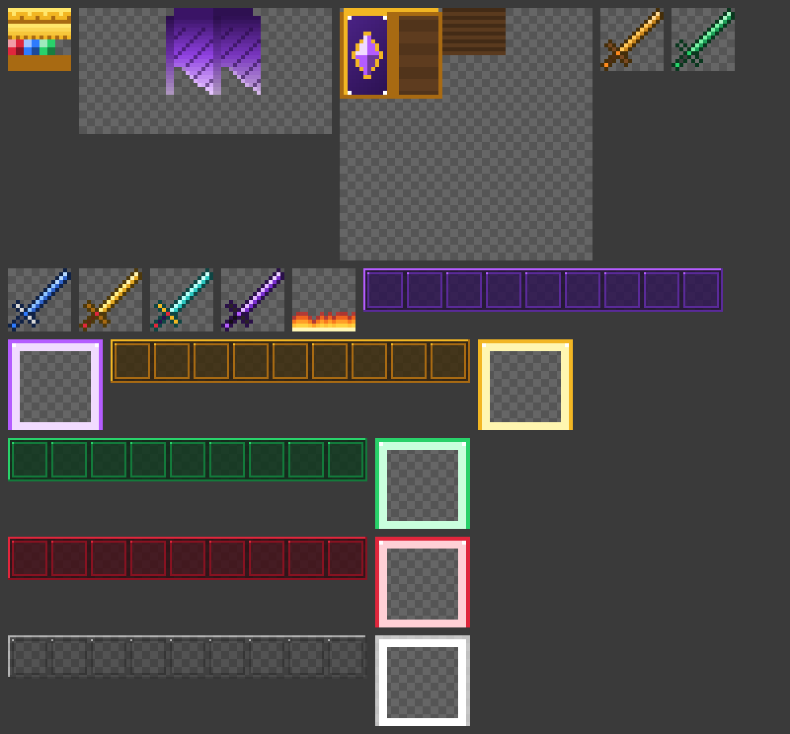

# MCBen Gems Resource Pack

Eigene Cosmetics + Utility-Packs für Minecraft **Java Edition 1.20.2 und neuer**
(getestet ausgelegt auf 1.21.x). Alle Packs sind einzeln – du kannst sie beliebig kombinieren.



## Download

Die fertigen Packs liegen in [`dist/`](dist/). Einfach die gewünschte `.zip` herunterladen
(auf die Datei klicken → „Download raw file“).

| Pack | Was es macht |
|------|--------------|
| `McBen-Cosmetics.zip` | **Krone** (statt geschnitztem Kürbis), **Flügel** (Elytra), **Schild**-Design, **Schwerter** (alle 6 Materialien im Edelstein-Look) |
| `McBen-LowFire.zip` | Feuer nur noch ~6/16 hoch → du siehst beim Brennen fast alles |
| `McBen-LowShield.zip` | Schild sitzt in der 1st-Person tiefer |
| `McBen-Hotbar-Amethyst/Gold/Emerald/Ruby/Glass.zip` | Eigene Hotbar (nur **eine** davon aktivieren) |

## Installation

1. Minecraft öffnen → **Optionen → Ressourcenpakete → „Pack-Ordner öffnen“**
   (oder `%appdata%\.minecraft\resourcepacks` unter Windows).
2. Die `.zip`-Dateien **ungeöffnet** in den Ordner ziehen.
3. Im Spiel die Packs nach rechts („Ausgewählt“) schieben → **Fertig**.
4. Falls „Für eine neuere/ältere Version erstellt“ steht: einfach trotzdem aktivieren.

## So benutzt du die Cosmetics

- **Krone:** Einen *geschnitzten Kürbis* (Kürbis + Schere) auf den Kopf setzen.
  Er sieht dann aus wie eine Krone, und das orange Kürbis-Overlay ist weg.
  Hinweis: Ein Resource Pack ist **clientseitig** – nur Spieler mit dem Pack sehen die Krone,
  alle anderen sehen weiter den Kürbis. Platzierte Kürbis-Blöcke bleiben normal.
- **Flügel:** Elytra anziehen. ⚠️ Wenn dein Account ein Cape hat, zeigt Minecraft auf der Elytra
  das Cape-Muster statt der Textur – dann Cape im Launcher/Skin-Menü abwählen.
- **Schild:** Ein Schild ohne Banner benutzen.
- **Schwerter:** Automatisch – alle Schwerter haben das neue Aussehen.

## Was mit einem Resource Pack *nicht* geht

- **Eigenes Cape:** Capes kommen vom Mojang-Account, Vanilla-Packs können sie nicht ändern.
  Geht nur mit einer Mod (z. B. eine eigene Fabric-Mod) oder OptiFine.
- **Krone/Flügel ohne Item:** Cosmetics, die *ohne* Item auftauchen oder die andere ohne Pack sehen,
  brauchen eine Mod bzw. ein Server-Plugin.

## Selbst anpassen (Farben, Feuerhöhe, …)

Alles wird aus [`config.json`](config.json) generiert. Farben ändern, dann:

```bash
pip install pillow
python3 build.py
```

Die neuen Zips landen in `dist/`, `preview.png` zeigt alle Texturen.

- `low_fire.height` – Flammenhöhe in Pixeln (1–16)
- `low_shield.offset_down` – wie weit das Schild nach unten rutscht
- `hotbars` – beliebig viele eigene Hotbar-Themes hinzufügen (`#RRGGBBAA` = mit Transparenz)
